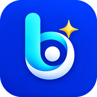
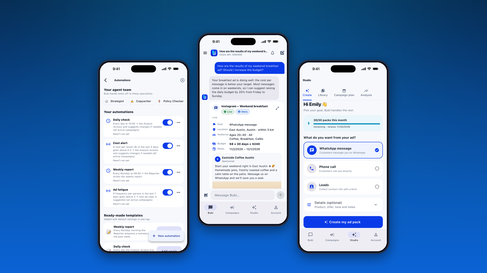

<p align="center">
  
</p>

<h1 align="center">Bubi Ads MCP Server</h1>

<p align="center">
  AI ad manager for local businesses — plan, build and manage <b>Meta (Facebook &amp; Instagram)</b>, <b>Google Ads</b>, <b>TikTok Ads</b> and <b>ChatGPT Ads</b> campaigns from Claude, ChatGPT, Cursor or any MCP client.
</p>

<p align="center">
  <a href="https://bubiads.com/en/">Website</a> ·
  <a href="https://bubiads.com/en/platforms/manage-ads-with-claude">Claude guide</a> ·
  <a href="https://bubiads.com/en/platforms/manage-ads-with-chatgpt">ChatGPT guide</a> ·
  <a href="https://glama.ai/mcp/connectors/com.bubiads/mcp">Glama</a> ·
  <a href="https://registry.modelcontextprotocol.io/v0/servers?search=com.bubiads">MCP Registry</a>
</p>

---

**Bubi Ads** is a hosted (remote) MCP server. There is nothing to install: point your MCP client at the endpoint and sign in with your Bubi Ads account.

| | |
| --- | --- |
| Endpoint | `https://bubiads.com/mcp` |
| Transport | Streamable HTTP |
| Auth | OAuth 2.1 (dynamic client registration) or a personal API key (`bubi_mcp_…`) |
| Scopes | `ads:read`, `ads:write` |
| Registry name | `com.bubiads/mcp` |
| Pricing | Free plan available; paid plans add messages, campaigns and automations |



## Safe by design

- **Nothing goes live without you.** Campaigns are created **paused** in your own ad account. Publishing happens only after you approve it in Bubi Ads.
- **Your account, your budget.** Ads run in the business's own Meta / Google / TikTok / ChatGPT Ads accounts; ad spend is paid directly to the platform.
- **Proposals, not silent changes.** Budget changes, pauses and negative keywords are created as proposals that you approve.
- **No LLM inside the MCP tools.** The tools return data and validate drafts; your assistant does the writing.

## Connect

### Claude (claude.ai and Claude Desktop)

Settings → Connectors → **Add custom connector** → URL `https://bubiads.com/mcp` → sign in with Bubi Ads.

### Claude Code

```bash
claude mcp add --transport http bubi-ads https://bubiads.com/mcp
```

Then run `/mcp` inside Claude Code and choose **Authenticate**.

### ChatGPT

Add `https://bubiads.com/mcp` as a connector / app (where your ChatGPT plan supports custom connectors) and sign in with OAuth.

### VS Code (GitHub Copilot agent mode)

`.vscode/mcp.json`

```json
{
  "servers": {
    "bubi-ads": {
      "type": "http",
      "url": "https://bubiads.com/mcp"
    }
  }
}
```

### Cursor, Windsurf and other clients (API key)

Create a personal key in Bubi Ads → Settings → Assistants, then:

```json
{
  "mcpServers": {
    "bubi-ads": {
      "url": "https://bubiads.com/mcp",
      "headers": {
        "Authorization": "Bearer bubi_mcp_YOUR_KEY"
      }
    }
  }
}
```

Keep the key secret; you can revoke it at any time in the same screen.

## Tools (26)

**Read**

| Tool | What it does |
| --- | --- |
| `get_account_overview` | Business profile, connected ad accounts, plan limits, campaigns, proposals and automations |
| `list_campaigns` | Campaigns with status and key metrics |
| `get_campaign_performance` | Performance of a campaign over time |
| `list_pending_proposals` | Changes waiting for your approval |
| `get_workflow_run` | Result of an agent workflow run |
| `list_automations` | Your automation rules |
| `get_competitor_insights` | Tracked competitors and analysis of their public ads |
| `get_health_score` | Advertising Health Score (0–100) across 7 areas, with top fixes |
| `simulate_scenario` | What-if estimates for budget, pause, shift, creative or audience changes |
| `get_meta_connect_link` | Link to connect a Facebook / Instagram ad account |
| `list_tiktok_videos` | TikTok videos that can be used as ads |
| `get_search_terms` | Google Ads search terms with wasted-spend analysis and suggested negatives |

**Write (drafts and proposals only — nothing is published)**

| Tool | What it does |
| --- | --- |
| `save_campaign_strategy` | Save a campaign draft written by your assistant; Bubi validates budgets, goals and text limits |
| `update_campaign_draft` | Edit a draft |
| `attach_ad_image` | Attach an image to a draft |
| `attach_ad_video` | Attach a TikTok video to a draft |
| `attach_tiktok_post` | Use an existing TikTok post as the ad |
| `prepare_campaign_in_ad_account` | Create the campaign **paused** in the ad account; returns an approval link |
| `propose_change` | Propose pause / budget / extend changes |
| `propose_negative_keywords` | Propose Google Ads negative keywords |
| `create_automation` | Create a rule that notifies you or creates proposals |
| `set_automation_enabled` | Turn an automation on or off |
| `add_competitor_ad` | Save a competitor ad text you pasted |
| `update_business_profile` | Create or update the business profile |
| `remember_fact` / `forget_fact` | Manage the business memory (goals, preferences, products) |

## Example prompts

- "Show my Bubi Ads account and tell me which campaign is wasting budget."
- "Plan an Instagram campaign for my café in Austin: WhatsApp messages, $10/day for 2 weeks."
- "What happens if I raise the budget of my best campaign by 30%?"
- "Which Google search terms should I exclude?"
- "Every Monday at 9:00, send me a weekly report."

## Also available as

Web app at [bubiads.com](https://bubiads.com/en/) and mobile apps on the
[App Store](https://apps.apple.com/app/id6821948471),
[Google Play](https://play.google.com/store/apps/details?id=com.bubiads) and
[Huawei AppGallery](https://appgallery.huawei.com/app/C119854583). Available in English, Turkish, German, Spanish, French, Portuguese, Arabic, Russian, Italian and Dutch.

---

### Türkçe

**Bubi Ads**, yerel işletmeler için yapay zekâ reklam asistanıdır. Bu MCP sunucusuyla Claude, ChatGPT veya Cursor içinden Meta (Facebook ve Instagram), Google Ads, TikTok ve ChatGPT reklamlarını planlayabilir, kendi reklam hesabınızda **duraklatılmış** olarak hazırlayabilir ve yalnızca siz onaylayınca yayınlayabilirsiniz. Adres: `https://bubiads.com/mcp` · Ayrıntılar: [bubiads.com/platformlar/claude-ile-reklam-yonetimi](https://bubiads.com/platformlar/claude-ile-reklam-yonetimi)

## Support

recep@bubiads.com · [bubiads.com/en/help](https://bubiads.com/en/help)

This repository contains documentation and the MCP Registry manifest (`server.json`) only; the server itself is hosted by Bubi Ads.
